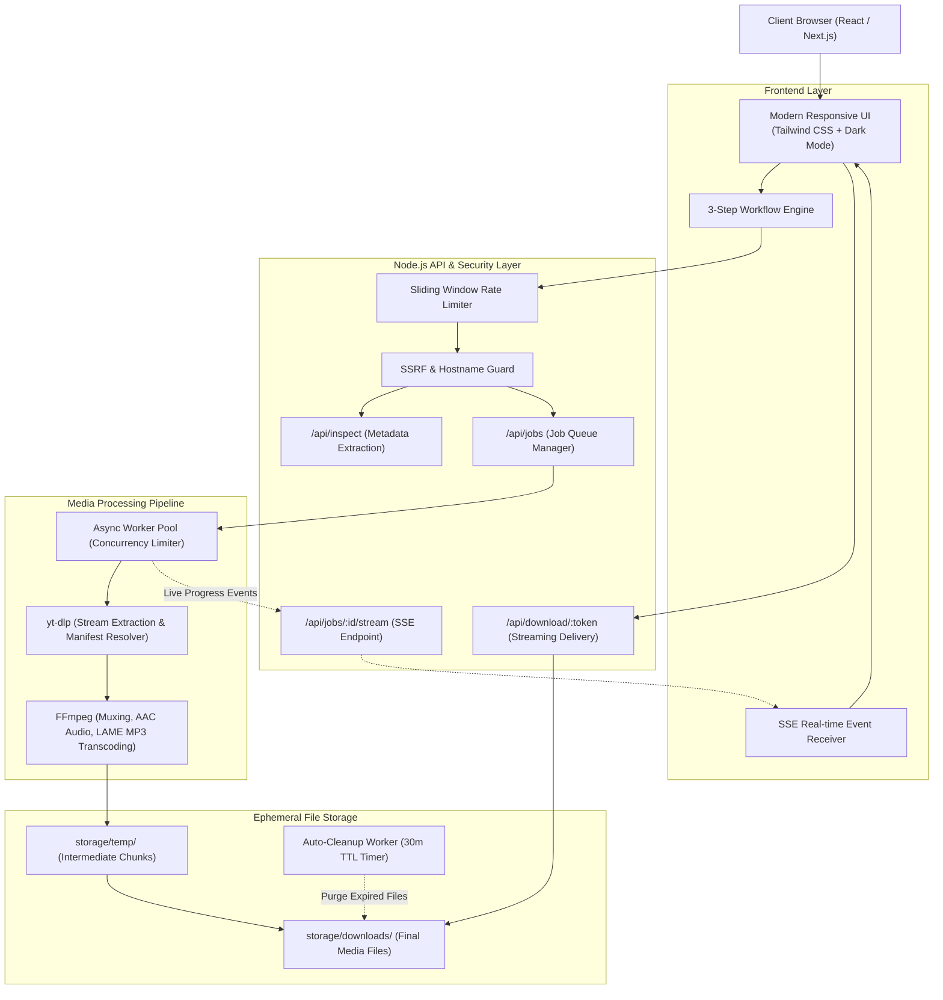
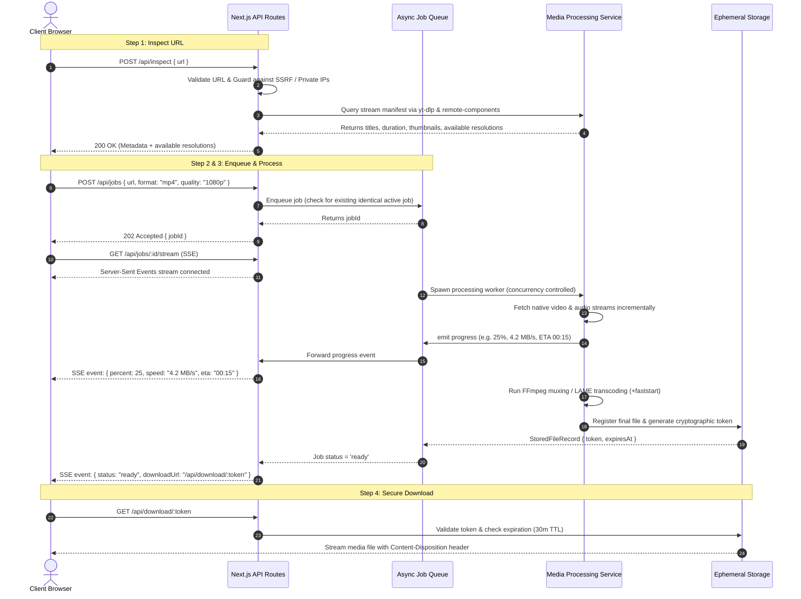

# MediaFlow — Enterprise Media Downloader & Transcoder

A high-performance, production-quality web application designed to inspect, transcode, and download authorized YouTube videos, YouTube Shorts, and audio streams in **MP4 (1080p Full HD, 720p, 480p, 360p)** and **MP3 (up to 320 kbps Studio Quality)**.

Built with **Next.js 14 (App Router)**, **TypeScript**, **Tailwind CSS**, native **FFmpeg**, and an asynchronous background job processing architecture with real-time **Server-Sent Events (SSE)** telemetry.

---

## 1. System Architecture



### Complete End-to-End Data Flow



---

## 2. Directory Structure

```
├── Dockerfile                  # Multi-stage production container with FFmpeg & Python
├── docker-compose.yml          # Container orchestration with volume mounts & resource limits
├── package.json                # Dependencies, scripts, and project metadata
├── tsconfig.json               # TypeScript config with path aliases (@/*)
├── tailwind.config.ts          # Tailwind CSS design system with dark mode
├── postcss.config.js           # PostCSS configuration
├── next.config.mjs             # Next.js optimization and image remote patterns
├── vitest.config.ts            # Vitest unit & integration test configuration
├── .env.example                # Documented configuration template
├── storage/                    # Ephemeral disk storage
│   ├── downloads/              # Completed ready-to-download files
│   └── temp/                   # Temporary intermediate chunks
├── src/
│   ├── app/
│   │   ├── api/
│   │   │   ├── inspect/
│   │   │   │   └── route.ts    # POST: URL validation, SSRF check, metadata inspection
│   │   │   ├── jobs/
│   │   │   │   ├── route.ts    # POST: Enqueues media processing job (duplicate-guarded)
│   │   │   │   └── [id]/
│   │   │   │       ├── route.ts # GET: Status polling; DELETE: Job cancellation
│   │   │   │       └── stream/
│   │   │   │           └── route.ts # GET: Server-Sent Events (SSE) live progress stream
│   │   │   └── download/
│   │   │       └── [token]/
│   │   │           └── route.ts # GET: Secure tokenized streaming file delivery
│   │   ├── globals.css         # Styling, themes, CSS variables, custom scrollbars
│   │   ├── layout.tsx          # Root layout with SEO metadata & theme support
│   │   └── page.tsx            # Main application UI orchestrator (3-step state machine)
│   ├── components/
│   │   ├── Header.tsx          # SaaS navigation bar, worker status, theme toggle
│   │   ├── Footer.tsx          # Architectural specs, license, legal terms link
│   │   ├── StepIndicator.tsx   # 3-Step visual progress breadcrumb
│   │   ├── ThemeToggle.tsx     # Smooth light/dark mode switch with persistence
│   │   ├── UrlInputStep.tsx    # Step 1: Input, paste/clear, validation, quick samples
│   │   ├── FormatQualityStep.tsx # Step 2: Thumbnail, MP4/MP3 tabs, quality cards, file size
│   │   ├── ProcessingStep.tsx  # Step 3: Real-time progress bar, speed, ETA, download CTA
│   │   ├── JobHistory.tsx      # Recent conversions drawer for the active session
│   │   └── LegalDisclaimerModal.tsx # Terms of use, authorized access, DRM boundary notice
│   ├── lib/
│   │   ├── types.ts            # Complete TypeScript domain contracts & API schemas
│   │   ├── utils.ts            # Byte formatters, duration formatters, Tailwind class merge
│   │   └── security.ts         # SSRF protection, URL regex, safe filename sanitizer
│   └── server/
│       ├── config.ts           # Centralized environment validator & binary resolver
│       ├── rate-limiter.ts     # In-memory sliding window rate limiter
│       ├── storage-service.ts  # Token generation, file registration, 30m TTL cleanup
│       ├── media-service.ts    # yt-dlp & FFmpeg execution wrapper, stream parsing
│       └── job-queue.ts        # Concurrency-controlled async job queue with cancellation
└── tests/
    ├── security.test.ts        # URL regex, SSRF defense, filename traversal tests
    ├── storage-service.test.ts # File registration, token lookup, disk cleanup tests
    ├── rate-limiter.test.ts    # Rate limiter thresholds and IP isolation tests
    ├── job-queue.test.ts       # Job states, duplicate prevention, cancellation tests
    └── api-routes.test.ts      # API route integration tests
```

---

## 3. Core Features & Technical Highlights

### 1. Robust Three-Step User Experience
- **Step 1: Paste Link**: Validates standard YouTube URLs, YouTube Shorts, and short links (`youtu.be`). Includes Clipboard Paste button, Clear button, and one-click quick sample buttons for instant evaluation.
- **Step 2: Format & Quality Selector**: Displays media thumbnail, title, channel, duration, and view count. Offers **MP4 Video** (1080p Full HD, 720p HD, 480p, 360p) and **MP3 Audio** (320k, 256k, 192k, 128k) with real-time estimated file sizes.
- **Step 3: Process & Download**: Live Server-Sent Events telemetry reporting download percentage, transfer speed (e.g. `4.5 MB/s`), and ETA. Features an instant **Cancel** action, direct browser download button, and link copy.

### 2. FFmpeg Transcoding Pipeline
- **Lossless Video Muxing**: Combines separate native video and AAC audio streams into clean `.mp4` containers.
- **Faststart Optimization**: Injects `-movflags +faststart` into output files so media begins playback immediately without requiring the browser to buffer the entire file first.
- **Audio Conversion**: Uses native `libmp3lame` to produce universal, high-fidelity MP3 files at configurable bitrates.

### 3. Asynchronous Job Queue & Concurrency Management
- Runs processing jobs in background workers without blocking standard HTTP API requests.
- Concurrency limit (`MAX_CONCURRENT_JOBS`, default 3-4) prevents server CPU/memory exhaustion.
- Enforces duplicate job prevention (returns existing active job if user submits identical request).
- Full cancellation support: Aborts child processes (`SIGTERM` followed by `SIGKILL`) and purges orphaned temporary files immediately.

### 4. Security & Hardening
- **SSRF Defense**: Strict whitelist of authorized domains (`youtube.com`, `youtu.be`). Rejects localhost, loopbacks (`127.0.0.0/8`, `::1`), private networks (`10.0.0.0/8`, `172.16.0.0/12`, `192.168.0.0/16`), and cloud metadata IP (`169.254.169.254`).
- **Command Injection Protection**: Child processes are invoked strictly with `spawn(binary, argsArray, { shell: false })`. No user strings are ever evaluated in a shell context.
- **Safe Filename Sanitization**: Strips directory traversal (`../`), null bytes, control characters, and OS reserved characters (`<>:"/\\|?*`). Normalizes Unicode diacritics and enforces strict 80-character maximum stem length.
- **Ephemeral Tokenized Storage**: Download links use 64-character cryptographic tokens. Completed files and tokens automatically expire after 30 minutes.
- **Sliding Window Rate Limiter**: Configurable per-IP rate limiting (e.g., 60 requests per minute) with standard `Retry-After` headers.

---

## 4. Local Development Setup

### Prerequisites
1. **Node.js**: v18.17+ (v20+ recommended).
2. **FFmpeg**: Installed and available in PATH (e.g. `brew install ffmpeg` on macOS, `apt install ffmpeg` on Ubuntu/Debian).
3. **Python 3 & yt-dlp**: `python3 -m pip install yt-dlp`.

### Step 1: Clone and Install Dependencies
```bash
git clone <repository_url>
cd "YouTube Downloader"
npm install
```

### Step 2: Environment Configuration
Copy `.env.example` to `.env.local`:
```bash
cp .env.example .env.local
```

Verify or adjust paths in `.env.local`:
```env
PORT=3000
NODE_ENV=development
APP_URL=http://localhost:3000
STORAGE_DIR=./storage/downloads
STORAGE_TEMP_DIR=./storage/temp
FILE_TTL_SECONDS=1800
MAX_CONCURRENT_JOBS=3
FFMPEG_PATH=/opt/homebrew/bin/ffmpeg   # or /usr/bin/ffmpeg
```

### Step 3: Run the Development Server
```bash
npm run dev
```
Open [http://localhost:3000](http://localhost:3000) in your browser.

---

## 5. Automated Testing

The project includes unit and integration tests powered by Vitest covering URL validation, SSRF mitigation, filename sanitization, rate limiting, storage cleanup, and API route contracts.

Run the test suite:
```bash
npm test
```

Watch mode for development:
```bash
npm run test:watch
```

---

## 6. Production Deployment

### Option A: Docker & Docker Compose (Recommended)

The provided multi-stage `Dockerfile` packages Node.js, FFmpeg, Python3, and `yt-dlp` in a hardened container running as a non-root user.

1. Build and start with Docker Compose:
```bash
docker compose up -d --build
```

2. View container logs:
```bash
docker compose logs -f
```

3. Stop the container:
```bash
docker compose down
```

### Option B: Standalone Linux Server (Ubuntu / Debian)

1. Install system dependencies:
```bash
sudo apt update
sudo apt install -y nodejs npm ffmpeg python3 python3-pip
sudo pip3 install yt-dlp
```

2. Build Next.js application:
```bash
npm ci
npm run build
```

3. Manage with PM2:
```bash
npm install -g pm2
pm2 start npm --name "mediaflow" -- start
pm2 save
pm2 startup
```

---

## 7. API Specification

### 1. `POST /api/inspect`
Inspects media metadata and determines available streams.

- **Request Body**:
  ```json
  {
    "url": "https://www.youtube.com/watch?v=dQw4w9WgXcQ"
  }
  ```
- **Response (200 OK)**:
  ```json
  {
    "success": true,
    "metadata": {
      "id": "dQw4w9WgXcQ",
      "url": "https://www.youtube.com/watch?v=dQw4w9WgXcQ",
      "title": "Rick Astley - Never Gonna Give You Up",
      "durationSeconds": 213,
      "durationFormatted": "3:33",
      "channel": "Rick Astley",
      "thumbnailUrl": "https://i.ytimg.com/vi/dQw4w9WgXcQ/maxresdefault.jpg",
      "availableResolutions": [
        { "id": "1080p", "label": "1080p Full HD", "isAvailable": true, "filesizeEstimateBytes": 68157440 },
        { "id": "720p", "label": "720p HD", "isAvailable": true, "filesizeEstimateBytes": 34078720 }
      ],
      "availableAudioQualities": [
        { "id": "320k", "label": "320 kbps — Studio High Quality", "bitrateKbps": 320, "filesizeEstimateBytes": 8520000 }
      ]
    }
  }
  ```

### 2. `POST /api/jobs`
Enqueues a media processing task in the background worker pool.

- **Request Body**:
  ```json
  {
    "url": "https://www.youtube.com/watch?v=dQw4w9WgXcQ",
    "format": "mp4",
    "quality": "1080p"
  }
  ```
- **Response (202 Accepted)**:
  ```json
  {
    "success": true,
    "jobId": "f78a2d103b4e"
  }
  ```

### 3. `GET /api/jobs/:id/stream`
Server-Sent Events endpoint pushing real-time progress updates.

- **Sample Stream Events**:
  ```
  data: {"status":"downloading","progress":{"phase":"downloading","percent":42,"downloadSpeed":"5.2MiB/s","eta":"00:12"}}
  data: {"status":"transcoding","progress":{"phase":"transcoding","percent":94,"message":"Muxing video & AAC audio tracks..."}}
  data: {"status":"ready","downloadUrl":"/api/download/a1b2c3d4...","fileSizeBytes":65412800}
  ```

### 4. `DELETE /api/jobs/:id`
Aborts an ongoing job immediately, terminates spawned FFmpeg processes, and frees worker resources.

### 5. `GET /api/download/:token`
Streams the completed media asset with `Content-Disposition: attachment` headers directly to the user's browser.

---

## 8. Known Limitations & Production Guidelines

1. **DRM & Protected Content**:
   - The application strictly operates on public, authorized, and user-owned media. It does not bypass DRM protections (Widevine, FairPlay, PlayReady) or paywalled streaming locks.

2. **YouTube Anti-Scraping / Challenge Solvers**:
   - Modern YouTube extraction requires solving dynamic JavaScript challenges. The pipeline is pre-configured with `--remote-components ejs:github` and `--js-runtimes node`. In high-volume cloud deployments (AWS, GCP, DigitalOcean), YouTube may rate-limit datacenter IP ranges; routing extractor queries through a residential proxy or rotating proxy pool is recommended for large-scale operations.

3. **Storage & Disk Retention**:
   - By default, processed files are held for 30 minutes (`FILE_TTL_SECONDS=1800`) before being automatically purged by the cleanup timer. In cloud container deployments without persistent volumes, ensure container disk allocation is appropriately scaled.

---

## 9. License

This project is licensed under the MIT License. Use responsibly in accordance with copyright law, content licenses, and source-platform terms of service.
